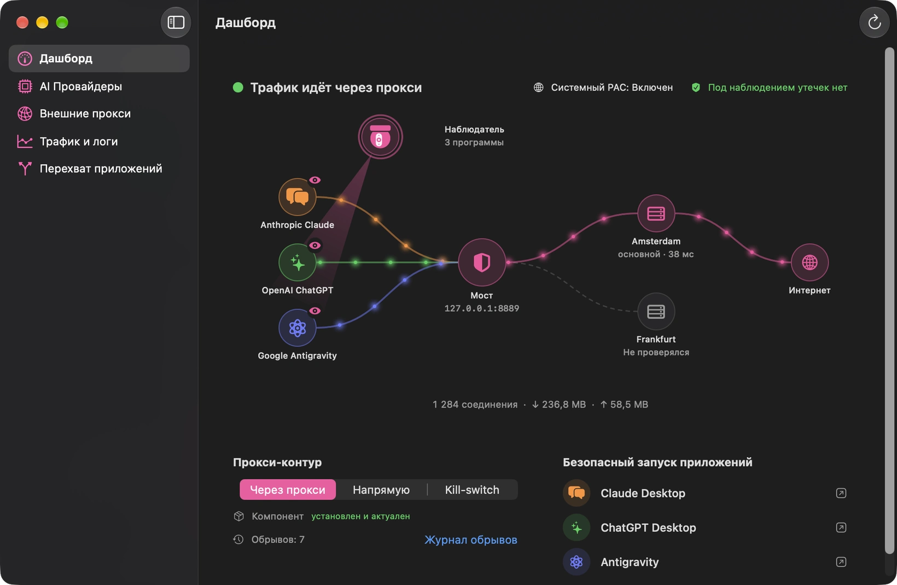
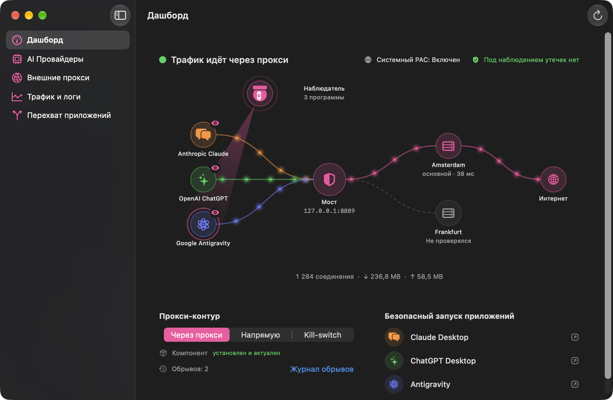
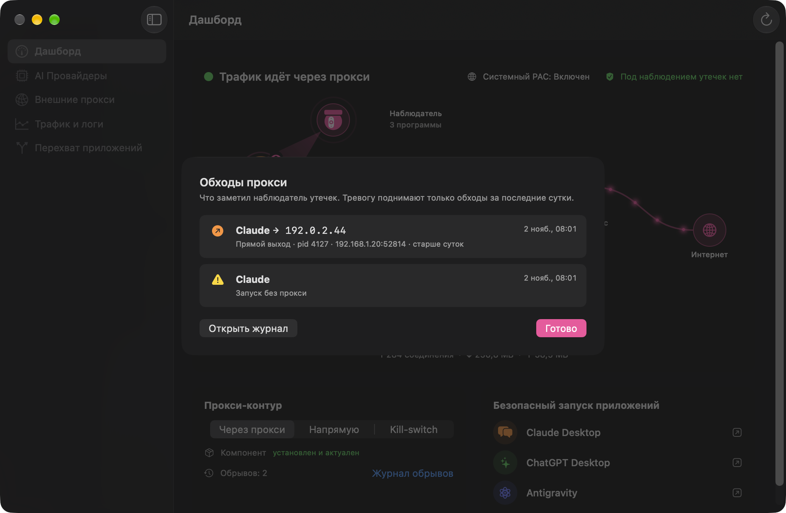
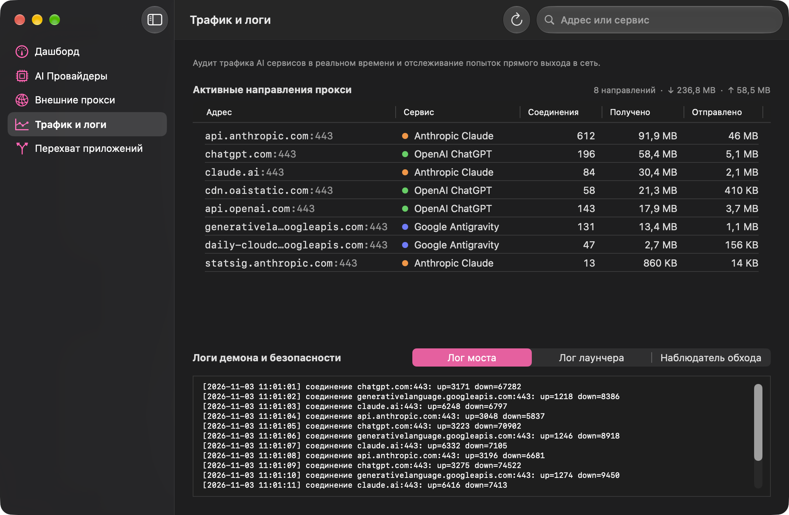
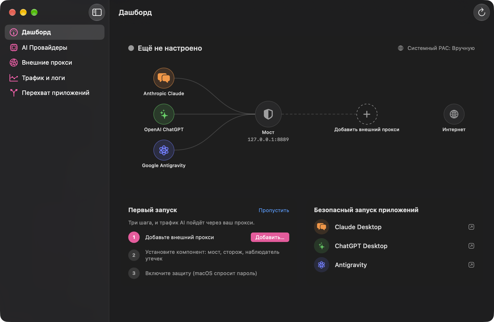

# AIProxy

### Ваш IP не утечёт в нейросети. Даже когда VPN отвалится.

Claude, ChatGPT и Antigravity ходят в интернет только через ваш прокси. 
Если связь оборвётся, их трафик остановится, а не уйдёт напрямую.

&nbsp;

macOS 26 и новее · Apple silicon · бесплатно

 

Трафик идёт через прокси. Прокси оборвался: мост блокирует всё, IP не утекает. Связь вернулась

 

## Зачем он нужен

Вы сидите через VPN и работаете в ChatGPT или Claude. VPN на секунду отваливается и переподключается. За эту секунду приложение успевает сходить в сеть напрямую, и сервис видит ваш настоящий IP. Вы этого даже не заметите.

AIProxy разделяет трафик. Нейросети ходят только через ваш прокси-сервер, отдельно от всего остального. Отвалится VPN, прокси или Wi-Fi, и их трафик просто остановится, а не уйдёт мимо. Сервис увидит только адрес прокси. А можно вообще не включать VPN: нейросети пойдут через прокси, всё остальное как обычно.

 

## Как это работает

| | Только VPN | AIProxy |
|---|---|---|
| **VPN отвалился** | Трафик на секунду уходит напрямую | Трафик нейросетей останавливается |
| **Какой IP видит сервис** | Ваш, если VPN моргнул | Только адрес прокси, всегда |
| **Остальной интернет** | Тоже через VPN | Как обычно, без лишних задержек |
| **Видно ли, что происходит** | Нет | Живая схема, наблюдатель и журнал обходов |
| **Обновился Claude и забыл про прокси** | Никто не заметит | AIProxy покажет, кто, куда и когда |

 

## Что умеет

### 🛡 Защита, которая не отпускает
Локальный мост пропускает трафик нейросетей только через ваш прокси. Блокировка прямого пути стоит на уровне системы, поэтому даже приложение, которое забыло настройки, наружу не выйдет. Режим Kill-switch дополнительно следит за обрывами и записывает каждый.

### 🗺 Живая схема
Сервисы, мост, ваши прокси и интернет на одном экране. Точки бегут быстрее, когда трафика больше. Обрыв видно сразу: мост краснеет и пульсирует.

### 🔀 Несколько прокси
Добавьте запасной прокси, и он появится на схеме. Нажмите на него, чтобы проверить задержку или сделать основным.

### 👀 Видно каждый обход
Если программа попыталась выйти мимо прокси, AIProxy покажет, какая, куда и когда. Нажмите на счётчик, и откроется список.

### 📊 Трафик по адресам
Таблица со всеми направлениями: какому сервису принадлежит адрес, сколько соединений, сколько получено и отправлено. Сортировка и поиск.

### 🚀 Безопасный запуск
Claude, ChatGPT и Antigravity открываются из AIProxy, только когда прокси отвечает. Не отвечает, и приложение не запустится.

### 📹 Наблюдатель
Отметьте программу, и наблюдатель выучит, куда она ходит. Дальше её адреса можно отправить через прокси или закрыть. На схеме он виден камерой: она осматривает программы под присмотром и краснеет, если какая-то пошла мимо прокси.

Если программа после обновления поднялась сама и потеряла настройки прокси, AIProxy перезапустит её с ними. А если перенаправить её нечем, закроет, чтобы она не вышла в интернет напрямую.

В разделе «Перехват приложений» видны все ваши программы, и у каждой понятно, идёт она через прокси или мимо.

### 🔄 Обновления
В Настройках AIProxy проверит новую версию на GitHub, скачает образ и сверит его контрольную сумму. Останется перенести приложение из открытого образа в «Программы».

 

## Приватность

- **Данные прокси остаются на вашем Mac.** Серверов AIProxy нет; только при проверке обновления приложение обращается к GitHub.
- **Никакой телеметрии и аналитики.**
- **Ваш прокси, ваши правила.** AIProxy работает с любым SOCKS5-прокси.
- **Локальные адреса не трогаются.** Программы на вашем Mac общаются друг с другом напрямую.

 

## Установка

1. Скачайте `AIProxy-<версия>.dmg` на странице [Releases](https://github.com/and-ray-m/AIProxy.app/releases/latest) и перетащите AIProxy в «Программы».
2. Откройте его. macOS предупредит, что не может проверить приложение: оно пока не заверено Apple. Нажмите «Готово».
3. Откройте **Системные настройки → Конфиденциальность и безопасность**, пролистайте вниз и нажмите **«Всё равно открыть»**.
4. Пройдите первый запуск: добавьте прокси, установите компонент и включите защиту. Для защиты macOS попросит пароль администратора. Без пароля ничего не изменится.

**Что нужно:** Mac с Apple silicon, macOS 26 или новее и свой SOCKS5-прокси. Сверить образ можно по контрольной сумме из файла `.sha256`.

 

## Что нового

Вся история версий в [CHANGELOG.md](CHANGELOG.md).

 

### Если AIProxy вам полезен

[**Оставить чаевые**](https://pay.cloudtips.ru/p/3ab3ad71)

